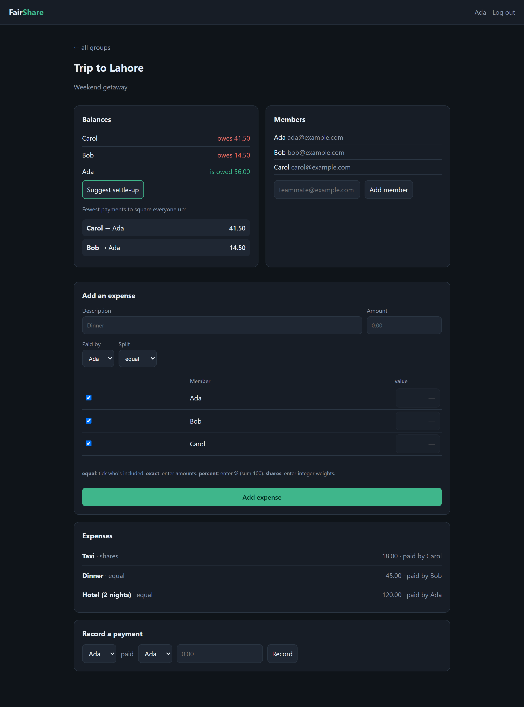

# FairShare

[](https://github.com/BoogeyCodes/fairshare/actions/workflows/ci.yml)


A shared-expense tracker — the Splitwise idea, built as a complete little web app. Create a group,
add the people in it, log who paid for what and how to split it, and FairShare keeps everyone's
running balance and tells you the **fewest payments** needed to settle up.

It's a real product, not a snippet: a FastAPI backend with a clean JSON API **and** a server-rendered
web UI (Jinja2 + a little HTMX), SQLAlchemy over SQLite, session-cookie auth, and a full test suite.



## What it does

- **Accounts & groups** — register, log in, create groups and invite members by email.
- **Flexible splits** — split an expense four ways:
  - **equal** across the people involved,
  - **exact** amounts per person,
  - **percent** (must total 100%),
  - **shares/weights** (e.g. `2:1:1`).
  All arithmetic is in **integer cents** with fair largest-remainder rounding, so shares always add
  back up to the exact total — never a missing or extra penny.
- **Balances** — each member's net position in the group (owed money, or owing it), always summing to zero.
- **Settle up** — a greedy debt-simplification algorithm that collapses everyone's balances into the
  **minimum number of payments**. If Carol owes Ada and Bob owes Ada, that's two payments; a chain
  (A owes B, B owes C) becomes one (A pays C).
- **Record payments** — log real settle-up payments; balances update accordingly.

## The settle-up algorithm

Given each person's net balance, the debtors (negative) and creditors (positive) are matched greedily —
biggest debtor to biggest creditor — settling the smaller of the two each time. This clears everyone in
**at most `n − 1` transfers** and, in practice, the fewest payments people actually have to make. A
member whose balance nets to zero (money flowing through them) simply drops out.

```python
simplify_debts({"A": -1000, "B": 0, "C": 1000})   # A pays C 10.00 — B isn't involved
```

## Architecture

```
src/fairshare
├── splitting.py   pure split strategies (equal / exact / percent / shares), integer cents
├── balances.py    pure balance computation + minimal settle-up
├── money.py       parse/format money <-> cents
├── models.py      SQLAlchemy ORM: User, Group, Membership, Expense, ExpenseShare, Settlement
├── services.py    application logic: the only layer that touches both the ORM and the pure core
├── schemas.py     Pydantic request/response models
├── api/routes.py  JSON API
├── web/routes.py  server-rendered pages (Jinja2 + HTMX)
├── templates/ , static/
├── security.py    PBKDF2 password hashing (standard library only)
└── app.py         composition root (session middleware, routers, DB)
```

The money logic (`splitting`, `balances`) is pure and has no idea the database exists, so it's trivial
to test exhaustively. `services.py` is the one place that joins that core to the ORM and holds the
rules (who may do what, how shares are computed); the API and the web UI are thin layers over it.

## Run it

```bash
pip install -e ".[dev]"
python -m fairshare            # http://127.0.0.1:8000  (web UI + /docs for the API)
```

Open the site, register, and create a group. The API is browsable at `/docs`. In production set a real
`FAIRSHARE_SECRET_KEY` (session signing) and `FAIRSHARE_DATABASE_URL`.

### Docker

```bash
docker build -t fairshare .
docker run --rm -p 8000:8000 -v fairshare-data:/data -e FAIRSHARE_SECRET_KEY=change-me fairshare
```

## Testing

```bash
pytest
```

58 tests: the split strategies (remainder distribution, tie-breaking, validation), the balance and
settle-up algorithms (net-to-zero, chain collapsing, the `n − 1` bound), money parsing/formatting, the
full JSON API (auth, membership/authorization, every split type, settlements) and a web-UI flow that
registers, creates a group, adds an expense and reads back the balances.

## API at a glance

| Method & path | Purpose |
| --- | --- |
| `POST /api/auth/register`, `/login`, `/logout`, `GET /api/auth/me` | Session auth |
| `POST/GET /api/groups`, `GET /api/groups/{id}` | Groups |
| `GET/POST /api/groups/{id}/members` | Members |
| `GET/POST /api/groups/{id}/expenses` | Expenses (all four split types) |
| `GET /api/groups/{id}/balances` | Net balance per member |
| `GET /api/groups/{id}/settle` | Suggested minimal settle-up transfers |
| `GET/POST /api/groups/{id}/settlements` | Recorded payments |

## Tech

Python 3.11+ · FastAPI · SQLAlchemy 2.0 + SQLite · Jinja2 + HTMX · Pydantic v2 · Starlette sessions ·
PBKDF2 (stdlib) · pytest · ruff · Docker · GitHub Actions.

## License

MIT
